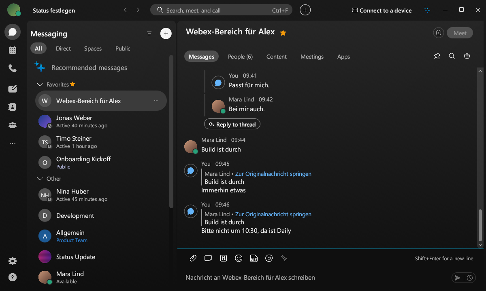

  

  <strong>Webox</strong> 
  A fast, native Webex desktop client for Windows and Linux, written in Rust.

  
  
  
  
  

> [!NOTE]
> Webox is an **unofficial, independent** client. It is not made, endorsed or supported by Cisco. Webex and Cisco are trademarks of Cisco Systems, Inc.

---

## What is Webox?

The official Webex app is a big Qt and Chromium bundle. Webox is one small Rust binary that draws the same interface with [egui](https://github.com/emilk/egui) and talks to the same Webex cloud services. You sign in with your normal Webex account, and your spaces, messages and calls are the same ones you see in the official app.

It follows the official app closely: layout, spacing, colours, icons, sounds and texts match it, so it feels familiar from the first start. It runs on Windows and on any Linux distribution, including NixOS.

### Why "Webox"?

**Web**ex plus **ox**, as in oxidation: oxidised iron is rust, and Webox is written in Rust.

  

## Features

- 💬 **Messaging**: spaces, direct chats and teams, threads, replies with quotes, edits, deletes, reactions, mentions, read receipts and rich text
- 🔐 **End-to-end encryption**: messages and files are encrypted with the Webex key service (KMS), like the official app
- 📎 **Files and pictures**: send and download files, inline images with a lightbox, link previews
- 😀 **Emoji and GIFs**: emoji picker and `:shortcode:` completion, GIF and sticker picker
- 📞 **Calls**: 1:1 audio calls over WebRTC, incoming call toasts, ringtones, dial pad
- 📅 **Meetings**: upcoming meetings and join by link
- 🔎 **Search**: global search for people, spaces and messages
- 🔔 **Notifications**: toasts, tray icon with unread badge, taskbar flash, do-not-disturb
- ⌨️ **Keyboard shortcuts**: the official shortcuts, customisable, with global hotkeys
- 🌍 **34 languages**: the official app's translations, when they are available on your machine ([details](docs/cisco-assets.md))
- 🧩 **Plugins**: a small native plugin API, with slash commands and a theme as examples, installable from plugin repositories ([docs/plugins.md](docs/plugins.md))
- 🐧 **Windows and Linux**: X11 and Wayland, with a Nix flake and NixOS/home-manager modules

## Get started

- 🪟 **Windows**: download `webox-<version>-windows-x64.zip` from the [latest release](https://github.com/PianoNic/Webox/releases), unpack it and start `webox.exe`. It needs the Edge WebView2 runtime, which Windows 10 and 11 already have.
- 🐧 **Linux**: download `webox-<version>-linux-x86_64.tar.gz`, unpack it and run `install.sh`. The run-time libraries are listed in [docs/LINUX.md](docs/LINUX.md).
- ❄️ **Nix / NixOS**: `nix run github:PianoNic/Webox`, or the modules in [docs/INSTALL-NIX.md](docs/INSTALL-NIX.md).
- 🛠️ **From source**: see the [developer setup](docs/dev-setup.md).

## Configuration

Signing in needs the OAuth client of the Webex desktop app, and the GIF picker needs a Giphy API key. Neither is part of this repository, and the release builds do not contain them either: they start, but sign-in says it is not configured. To sign in, build Webox yourself with your own values: copy `secrets.example.toml` to `secrets.toml`, fill it in and run `cargo build --release` (or set the environment variables, at build or run time):

| Key in `secrets.toml` | Environment variable | Used for |
| --- | --- | --- |
| `webex_client_id` | `WEBOX_CLIENT_ID` | sign-in |
| `webex_client_secret` | `WEBOX_CLIENT_SECRET` | sign-in and token refresh |
| `giphy_api_key` | `WEBOX_GIPHY_API_KEY` | GIF and sticker picker |

Without them Webox still starts: the sign-in screen says it is not configured, and `webox --sample` shows the whole app with made-up data.

Settings live in `%APPDATA%\WebOx` on Windows and `~/.config/webox` on Linux.

## Documentation

- 🏗️ **[Architecture](docs/architecture.md)**: source layout, launcher behaviour and sign-in
- 🎨 **[Assets](docs/cisco-assets.md)**: which icons, sounds and texts come from where, and under which licence
- 🐧 **[Linux](docs/LINUX.md)** and **[Nix](docs/INSTALL-NIX.md)**

## License

[MIT](LICENSE). Copyright PianoNic. Third-party licences are in [THIRD_PARTY_NOTICES.md](THIRD_PARTY_NOTICES.md).

---

Made with care by <a href="https://github.com/PianoNic">PianoNic</a>

